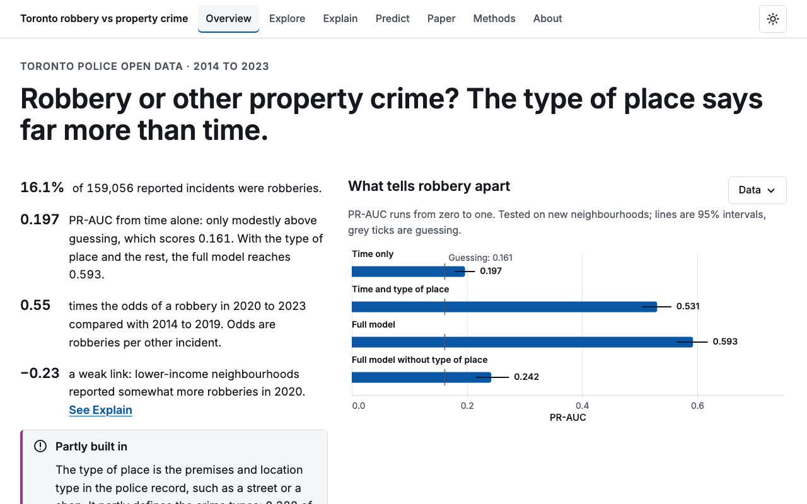
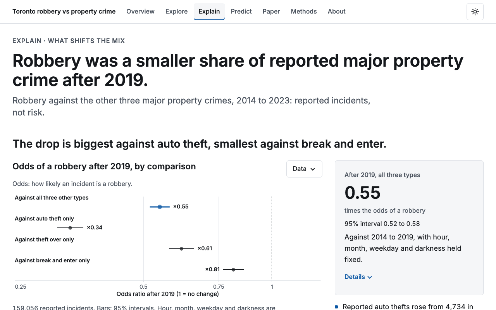
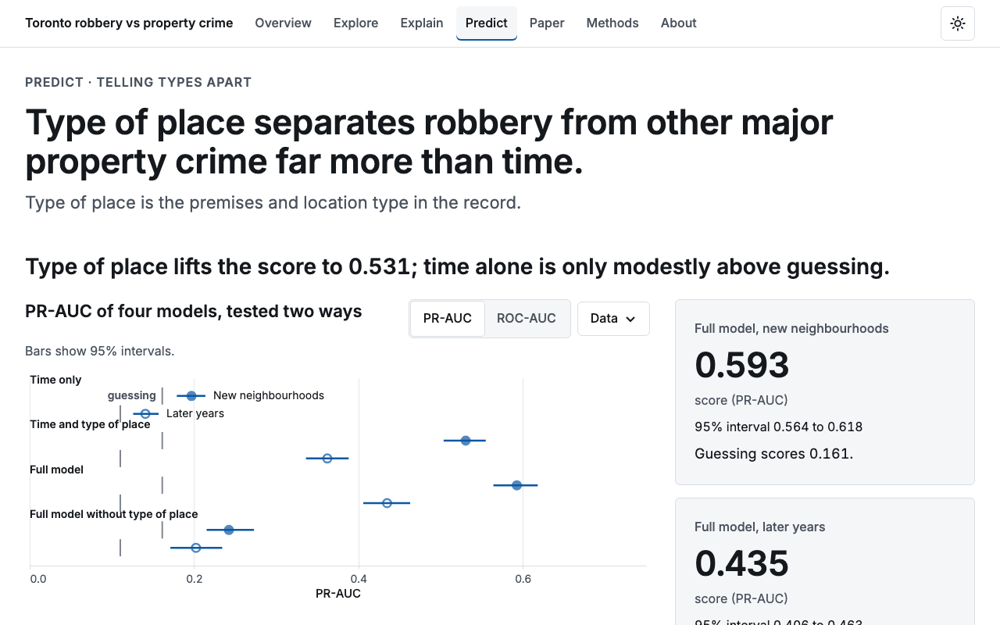
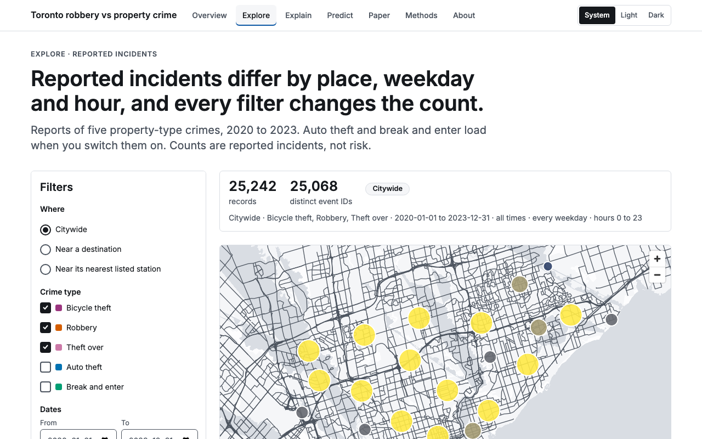

# Toronto Crime Analytics

**What makes a reported robbery different from other property crimes in Toronto?**

The hour, the setting, the neighbourhood—each seems like it should tell us something. We used Toronto Police Service open data from 2014–2023 to find out which patterns hold up, and which actually help distinguish robbery from auto theft, break and enter, and theft over.

The most interesting finding: **a pattern can be statistically clear and still be a weak predictor.** Time matters in the regression, but knowing the kind of place where an incident was recorded adds much more to the models.

[Read the paper](web/public/paper/paper.pdf) · [See the full results](RESULTS.md) · [Browse the analysis](pipeline/src/tca/)

## What we wanted to know

- **When does robbery make up a larger share of reported property crime?** We looked at hour, month, weekday, darkness, and how the mix changed after 2019.
- **Which details help identify the crime type?** We added time, place, and neighbourhood census features in stages, then compared logistic regression, random forest, and XGBoost.
- **Do those patterns hold up beyond the data used to fit the models?** We tested on held-out neighbourhoods and on later years, training through 2021 and testing on 2022–2023.

## What we found

**The clock tells only part of the story.** Several time patterns are statistically clear, but time alone barely improves on the baseline for identifying robberies. The biggest improvement comes from adding premises, location type, and coordinates; census features add relatively little after that.

| What the model knows | PR-AUC (95% bootstrap interval) |
|---|---:|
| Time only | 0.197 (0.179–0.214) |
| Time + place | 0.531 (0.504–0.555) |
| Time + place + census | 0.543 (0.518–0.566) |
| Random forest with those features | 0.593 (0.561–0.620) |
| XGBoost with those features | 0.593 (0.564–0.618) |

These scores use neighbourhood-grouped cross-validation. PR-AUC summarizes the trade-off between finding robberies and avoiding false positives; higher is better. A constant-score baseline is 0.161. Values and intervals come from the [prediction results](results/predict/predict.ablation.json).

**Much of that improvement comes from how crime types are defined.** Premises and location type partly distinguish the categories themselves—a break and enter, for example, involves a building. Remove those two features and XGBoost's PR-AUC falls to **0.242 (95% interval: 0.215–0.273)**. That makes the strong full-model score easier to put in perspective.

**The mix of reported crime changed after 2019.** Robbery became less prominent relative to the other categories, with rising auto theft contributing to the shift. A smaller robbery share does not, by itself, mean a lower chance of being robbed. The later-year test also showed weaker model performance, and XGBoost offered no clear PR-AUC gain over random forest on held-out neighbourhoods.

Throughout, we ask **which type of crime an already-reported incident is**. These results describe reported crime composition, not personal safety, future crime locations, or cause and effect.

## Explore the project

The interactive site lets you follow the analysis from the citywide picture to individual model comparisons:

- **Explore:** filter reported incidents and browse maps and charts.
- **Explain:** inspect time patterns, odds ratios, and neighbourhood income and job-ratio comparisons, including a rotatable 3D view.
- **Predict:** see what each set of features adds, compare models, and check what happens when premises information is removed.
- **Paper:** read the research questions, methods, results, and limitations together.

| Overview | Explain |
|---|---|
|  |  |
| **Predict** | **Explore** |
|  |  |

## How it is built

A validated **Python pipeline** prepares the data, fits the models, and produces the results behind both the **React + TypeScript site** and the **LaTeX paper**. Vega-Lite powers the charts, MapLibre the map, and Plotly the interactive 3D view.

The site and paper share the same result files, so their numbers stay in sync. [RESULTS.md](RESULTS.md) traces the published findings to those files; [parity/](parity/) records checks against reference R implementations, and [CHANGES.md](CHANGES.md) documents analytical improvements.

## Reproduce

Needs Python 3.12, Node 24 or newer, R only for the optional reference re-runs, and tectonic and poppler for the paper.
Everything installs inside the repository folder.

```bash
make env        # Python venv, node dependencies, Playwright Chromium (make python first if Python 3.12 is absent)
make data       # fetch the pinned input files and verify their checksums
make parity     # Python ports against the committed R outputs
make analysis   # result files (about 70 minutes, mostly the ablation ladder)
make paper      # numbers, tables, figures and the PDF (at most 7 content pages; references on their own page)
make web        # build the static site in web/site
make audit      # honesty audit of every numeral, bundle budgets, PDF checks
make check      # unit tests and lint
```

`make rref` re-runs the original R projects (hours); the committed `parity/r_outputs/` are used otherwise. The Toronto
basemap used by Explore (`web/public/basemap/toronto.pmtiles`, 20 MB, sha256 pinned) is committed; `tools/fetch_basemap.sh`
records how it was extracted from Protomaps and verifies its checksum.

Two runs on the same machine give identical result hashes (`results/CHECKSUMS.sha256`); `tools/fresh_checkout.sh`
verifies this in a fresh clone.

## Data and licences

- Code: MIT, see `LICENSE`.
- Data are not committed and are not covered by the code licence. Toronto Police Service open data are used under the Open
  Government Licence – Ontario; City of Toronto neighbourhood profiles under the Open Government Licence – Toronto. See
  `DATA_LICENSE.md` for terms, attribution and limits.
- Contains information licensed under the Open Government Licence – Ontario, and under the Open Government Licence –
  Toronto. This is an independent analysis, not endorsed by the Toronto Police Service or the City of Toronto.
- Basemap tiles are built from OpenStreetMap data (© OpenStreetMap contributors, ODbL) by Protomaps.

## Repository map

`pipeline/` Python package and tests · `parity/` R reference re-runs, outputs and comparison scripts · `results/` the only
source of published numbers · `web/` the site · `paper/` the paper · `design/` tokens and design system · `tools/` build,
audit and check scripts · `reviews/` review reports (honesty, design, security) · `PLAN.md`, `AGENTS.md`, `PROGRESS.md`
the plan, working rules and state.
